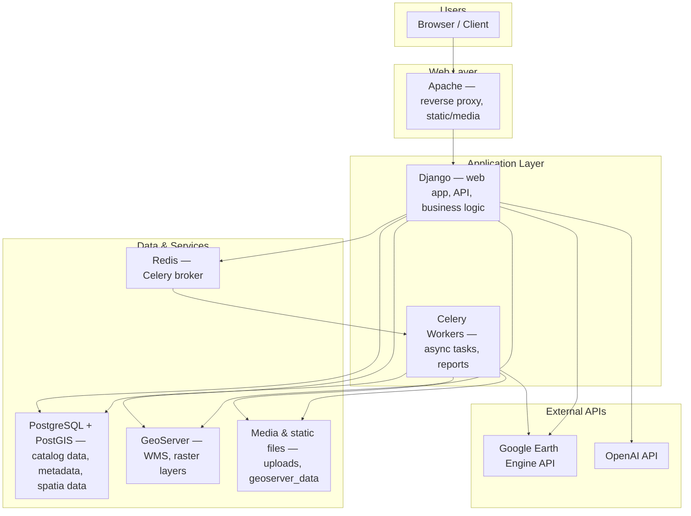
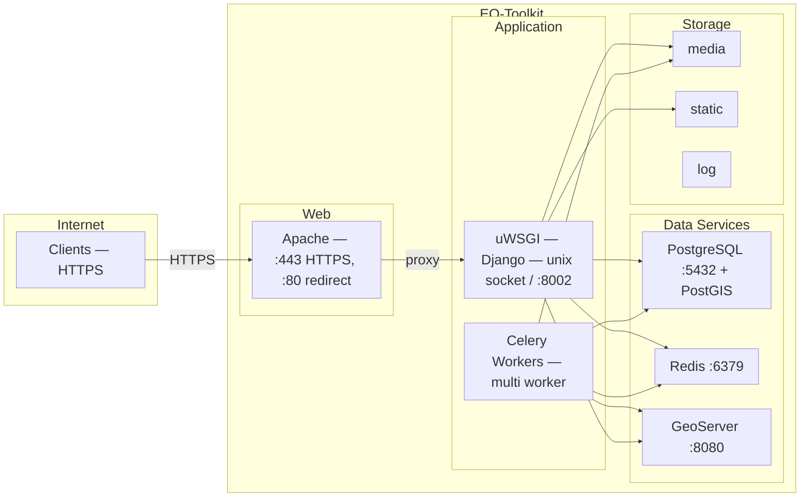
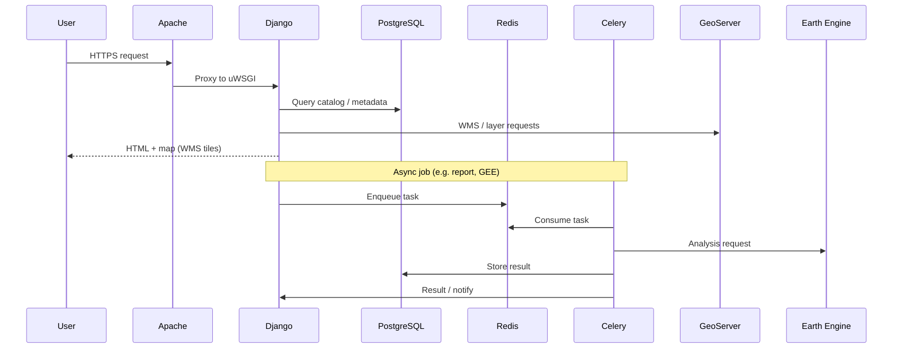

# Technology Stack and Workflow

---

## Technology Stack

### Frontend Technologies

- **Django** – For fast, server-rendered UI delivery
- **HTML, CSS, JavaScript** – Core web technologies for UI and interactions
- **Material UI + jQuery** – Responsive design and UI interactions

### Geospatial and Mapping

- **OpenLayers** – Lightweight JavaScript library for interactive, customizable web maps
- **GeoServer** – Open-source map server for sharing raster and vector data via OGC standards
- **WMS (Web Map Service)** – For streaming geospatial raster data (e.g. LULC, NDVI)
- **Custom Tile Layers** – Integration of Google Earth Engine tiles for real-time Earth Observation data

### Backend Services

- **Django** – Python-based web framework for robust API and server logic
- **GDAL** – Geospatial Data Abstraction Library for raster and vector processing
- **Google Earth Engine API** – For accessing petabyte-scale EO data and on-the-fly analysis

### Database and Storage

- **PostgreSQL** – Relational database for structured project metadata
- **PostGIS** – Spatial extension for PostgreSQL, enabling spatial queries and geometry storage

---

## How It Works

The platform is designed to make the discovery, understanding, and application of Earth Observation (EO) resources simple and impactful. It follows a user-friendly workflow that enables project teams and stakeholders to move from exploration to informed action.

### 1. User Interface and Input

- Users begin by selecting filters, keywords, and parameters such as theme, project phase, and project site.
- Keyword search and spatial filtering allow targeted exploration.
- The interface dynamically captures user preferences and sends them as query parameters.

### 2. Backend Processing

- The server receives the query parameters and processes them against the pre-curated catalog of datasets, training materials, and case studies.
- Filtering logic is applied to return only relevant records based on user selections.

### 3. Results and Visualization

- Filtered results are returned and displayed
- For selected datasets, users can explore spatial layers on an embedded map with legends and basemap controls.
- Data can also be further analyzed, visualized, or downloaded depending on its type and availability (e.g. raster layers, time series, EO maps).

---

## Architecture Diagram

High-level logical architecture: how users interact with the platform and how main components connect.

### Architecture summary

| Layer | Components | Role |
|-------|------------|------|
| **Users** | Browser | Access UI, maps, catalogs, and analyses |
| **Web** | Apache | Reverse proxy, SSL, static/media serving |
| **Application** | Django, Celery | Web app, API, async jobs (reports, GEE analyses) |
| **Data** | PostgreSQL/PostGIS, GeoServer, Redis, Media | Persistence, spatial layers, task queue, file storage |
| **External** | Google Earth Engine, OpenAI | EO data and  AI features |

---

## Infrastructure Topology

Deployment view: how services run on the server and how they connect (ports, protocols, and data flow).

### Infrastructure summary

| Component | Role | Typical interface |
|-----------|------|--------------------|
| **Apache** | HTTPS termination, reverse proxy to app, serve static/media | Port 443 (80 → redirect) |
| **uWSGI** | Runs Django (WSGI); socket or TCP to Apache | Unix socket or 127.0.0.1:8002 |
| **Celery** | Async tasks (reports, GEE, uploads) | Connects to Redis |
| **PostgreSQL** | Main database + PostGIS | localhost:5432 |
| **Redis** | Celery broker and result backend | localhost:6379 |
| **GeoServer** | WMS/raster/vector layers | Same host :8080 or separate |
| **Media / static / log** | File paths under project root | `/path/to/etoolkit/{media,static,log}` |

---

## Data Flow (simplified)

